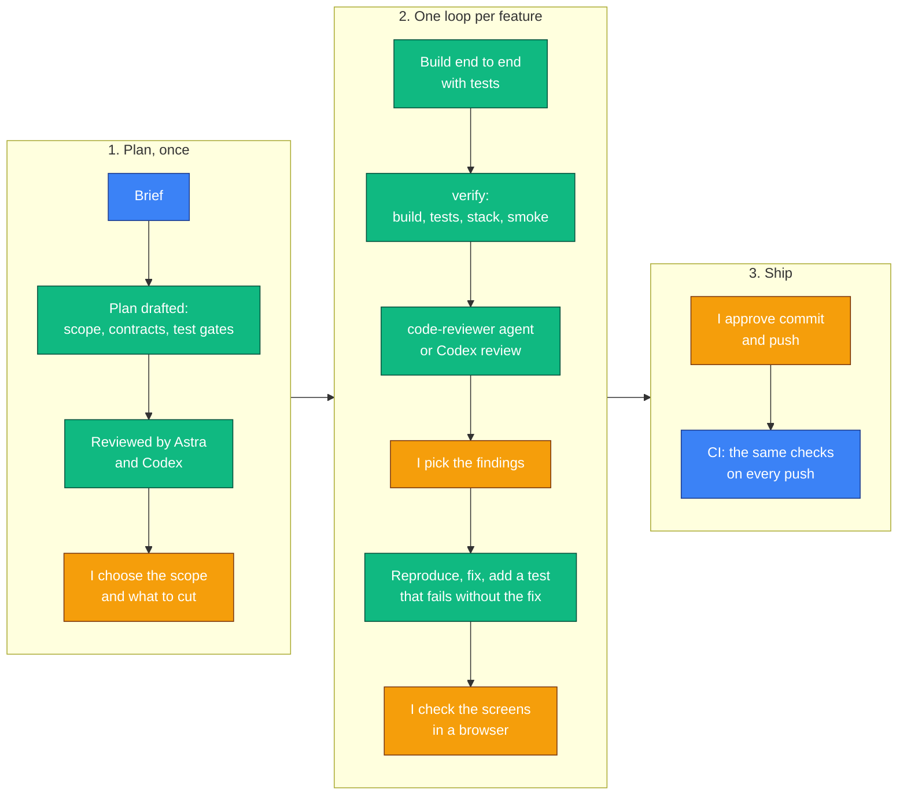

# Movie Catalog

A movie catalog with artwork, cast and creators. It has a Svelte + TypeScript frontend and
Kotlin Spring Boot services: the frontend talks to the backend over GraphQL, and the
services talk to each other over gRPC.

> **Status: in progress.** You can list, create, view, edit and delete movies and people, upload,
> replace and remove movie artwork, and credit people on movies as cast or creators, through the
> whole stack. Search is next.

## Architecture

```text
Browser -> nginx (static web, /graphql and /media proxies)
              -> gateway (GraphQL and image GET)
                   -> gRPC -> catalog-service -> Postgres catalog database
                   -> gRPC -> media-service   -> Postgres media database + file volume
```

| Module | What it is |
|---|---|
| `proto/` | Shared `.proto` contracts; generates Java messages and gRPC stubs |
| `services/catalog-service` | Movies, people, credits and search (gRPC server) |
| `services/media-service` | Artwork storage, validation and thumbnails (gRPC server) |
| `services/gateway` | GraphQL API and image downloads for the web app; calls the other services over gRPC |
| `web/` | SvelteKit single-page app, served by nginx in Docker |

## Run everything with Docker

Needs only **Docker with Compose** (Docker Desktop or Colima).

```bash
docker compose up --build --wait
```

Then open **http://localhost:3000**. The first build takes a few minutes while Gradle and npm
download dependencies. Services start in order as each reports healthy.

To stop, run `docker compose down`. To also **delete all data** (movies and uploaded images),
run `docker compose down -v`.

Only the web app (port 3000) and Postgres (5432, for development) are published, and only on
`127.0.0.1`. To change ports or passwords, copy `.env.example` to `.env` and edit it.

## Develop locally

Needs **JDK 17+** to run Gradle (the build uses Java 21, downloaded automatically if missing),
**Node.js 22**, and Docker.

```bash
docker compose up -d --wait postgres
```

Then start each service in its own terminal:

```bash
./gradlew :services:catalog-service:bootRun
```

```bash
./gradlew :services:media-service:bootRun
```

```bash
./gradlew :services:gateway:bootRun
```

```bash
cd web && npm install && npm run dev
```

Open **http://localhost:5173**. Vite forwards `/graphql` and `/media` to the gateway on port 8080.

| Component | Port |
|---|---|
| web (Vite dev server) | 5173 |
| gateway (HTTP; GraphQL at `/graphql`, images at `/media/{id}`) | 8080 |
| catalog-service (gRPC) | 9091 |
| media-service (gRPC) | 9092 |
| Postgres | 5432 (`POSTGRES_PORT`) |

`bootRun` does not read `.env`; only Compose does. The services' defaults match `.env.example`.
If you change the Postgres port or a password, export the matching variables before `bootRun`,
for example `CATALOG_DB_URL=jdbc:postgresql://localhost:5433/catalog`. Each service lists its
variables in `src/main/resources/application.yml`. Uploaded images go to `./media-data`
unless `MEDIA_STORAGE_DIR` is set.

After changing `services/gateway/src/main/resources/graphql/schema.graphqls`, regenerate the web
app's types with `cd web && npm run codegen`.

### Colima

Colima doesn't use the default Docker socket, so Testcontainers needs two variables before
`./gradlew build`:

```bash
export DOCKER_HOST="unix://$HOME/.colima/default/docker.sock"
export TESTCONTAINERS_DOCKER_SOCKET_OVERRIDE=/var/run/docker.sock
```

If `docker compose` reports an unknown command, use `docker-compose` instead. Alternatively,
add Homebrew's plugin folder to `cliPluginsExtraDirs` in `~/.docker/config.json`.

## Tests

```bash
./gradlew build
```

runs every backend test. Tests that need Postgres start their own database with Testcontainers,
so Docker must be running.

```bash
cd web && npm test
```

runs the web unit tests. `npm run check` type-checks and `npm run lint` checks formatting and
lint rules.

### Browser smoke test

`web/e2e/smoke.spec.ts` drives one user flow in Chromium against the running stack, through nginx
and the real services:
- create a movie, upload artwork and see it displayed, and reload the movie's URL
- check that bad uploads are refused with a message
- edit the movie, checking that the form is locked while the save is in flight
- recover from a conflict: an edit is refused because someone else saved first, and Reload
  shows their version
- leave the edit page while a save is in flight: the save is confirmed, but does not pull the
  user back to the movie
- receive delayed field-error and timeout responses after leaving both edit forms: a toast
  explains the outcome and the new draft keeps its focus and values
- use Back/Forward during deletion: a reused detail page clears the old dialog and stays usable
- remove the artwork and delete the movie, each after a confirmation
- add, edit and delete a person, with the form's validation messages
- credit the person on a movie as cast and as a creator, with the form locked while the save is
  in flight; a duplicate role is refused, editing replaces the character and billing order, and a
  credit removed elsewhere while being edited is explained
- see the person's credits on their page, and have their deletion refused until the credits are
  removed

The successful in-flight steps hold real GraphQL responses (the server has already saved).
The late-failure steps inject delayed field-error and timeout responses. Neither depends on
connection timing.

Start the stack and wait until every service is healthy:

```bash
docker compose up --build --wait
```

Install the web dependencies and Playwright's Chromium (on Linux, add `--with-deps` to also
install the system libraries Chromium needs):

```bash
cd web && npm ci && npx playwright install chromium
```

Then run the test from `web/`:

```bash
npm run test:e2e
```

The test targets `http://localhost:3000` by default. If the app is somewhere else, for example
after changing `WEB_PORT` in `.env`, set `E2E_BASE_URL`:

```bash
E2E_BASE_URL=http://localhost:8081 npm run test:e2e
```

A run that passes deletes the movie and person it created. A failed or interrupted run can leave
a movie named "Smoke test …" or a person named "Ada Smoke …" behind; they do not affect later
runs, and `docker compose down -v` clears all data.

CI runs all of these on every branch push and on pull requests (`.github/workflows/ci.yml`). Its
`stack` job builds the Docker images, starts the stack, and runs the browser smoke test against
it, uploading the Playwright report if it fails.

## API at a glance

GraphQL at `POST /graphql`; the full schema is
[`schema.graphqls`](services/gateway/src/main/resources/graphql/schema.graphqls).

```graphql
query {
  movies(page: { offset: 0, limit: 12 }) {
    totalCount
    items { id title releaseDate artworkUrl(variant: THUMBNAIL) }
  }
}
```

Updates replace every editable field and carry the version that was read; a stale version is a
`CONFLICT`. Every successful movie/person update and artwork attach/remove advances the movie
or person version exactly once, including requests whose values are unchanged.

People are listed alphabetically using Postgres's `und-x-icu` collation. Case and accents can
break ties between otherwise equivalent letters; the ID breaks ties between identical names.
The original V2 migration comment says these distinctions are ignored, but that is inaccurate;
the applied migration is kept unchanged to preserve its Flyway checksum.

For example:

```graphql
mutation {
  updatePerson(id: "<id>", version: 1, input: { name: "Amy Adams", birthDate: "1974-08-20" }) {
    version
  }
}
```

Credits link a person to a movie as `CAST`, `DIRECTOR`, `WRITER` or `PRODUCER`. Only cast
credits have a character name; the billing order (0 to 1000) sorts each list. A person can hold
several roles on one movie, but the same role and character twice is a `CONFLICT`. Credits are
last-write-wins: they carry no version, and changing them does not change the movie's or the
person's version. Deleting a movie deletes its credits; a person with credits cannot be deleted
(`FAILED_PRECONDITION`) until those are removed.

```graphql
mutation {
  addCredit(input: { movieId: "<id>", personId: "<id>", type: CAST, characterName: "Louise Banks", billingOrder: 0 }) {
    id
    person { name }
  }
}
```

A movie's `cast` and `creators`, and a person's `credits`, are loaded in one catalog call per
field for a whole page, not one call per movie or person.

`people(nameContains: "amy")` lists only people whose name contains the text, ignoring case;
the credit form uses it to find anyone, however long the list of people.

Artwork is uploaded with the
[GraphQL multipart request spec](https://github.com/jaydenseric/graphql-multipart-request-spec):

```bash
curl http://localhost:3000/graphql \
  -F 'operations={"query":"mutation($f: Upload!){ uploadArtwork(movieId: \"<id>\", version: 1, file: $f){ version artworkUrl } }","variables":{"f":null}}' \
  -F 'map={"0":["variables.f"]}' \
  -F '0=@poster.png;type=image/png'
```

Images are JPEG or PNG, up to 5 MB and 8000×8000 pixels. Errors carry `extensions.code`
(`BAD_REQUEST` with `fieldErrors`, `NOT_FOUND`, `CONFLICT`, `FAILED_PRECONDITION`,
`RESOURCE_EXHAUSTED`, `SERVICE_UNAVAILABLE`, ...).

## How AI tools were used

I used AI tools as assistants, the way I would use a search engine or a second reviewer. The
scope and design decisions are mine. Builds, tests, runtime checks and independent reviews
are used to verify changes. Some refactor commits preceded full Docker/browser verification;
commit messages record those gaps. Check the CI run for the exact commit being reviewed.

**Tools**
- **Claude Code** (Anthropic): turning the brief into a plan, checking current library
  versions, and writing code and tests from my prompts, one slice at a time.
- **Astra**, a second AI agent: reviewed the plan and the first working slice.
- **Codex** (OpenAI): independent reviews of individual commits.

**How the work was done.** Green steps are done by an AI tool, orange ones by me; nothing moves
on without my decision.



The loop is written down in the repository, as plain Markdown that Claude Code reads:

| File | What it is |
|---|---|
| [`CLAUDE.md`](CLAUDE.md) | The conventions every run follows: stack, code style, testing rules, the process |
| [`.claude/skills/verify`](.claude/skills/verify/SKILL.md) | The checks run after every change, reported as PASS or FAIL |
| [`.claude/skills/gen-tests`](.claude/skills/gen-tests/SKILL.md) | Where each kind of test goes, and the edge-case checklist |
| [`.claude/skills/ship-slice`](.claude/skills/ship-slice/SKILL.md) | The whole loop for one feature |
| [`.claude/agents/code-reviewer.md`](.claude/agents/code-reviewer.md) | A read-only reviewer that runs the tests but never edits code |

I wrote these down partway through, once the loop had settled over the first slices, and used
them from then on. My plan and working log stay outside the repository.

**What the checks caught**, for example:
- Spring for GraphQL answered multipart uploads with HTTP 415 before the upload handler could
  run; the handler is now a router function ordered ahead of it.
- A Kotlin builder field shadowed the value being copied, so every artwork change reported a
  previous artwork of `""`. The tests caught it before commit.
- Truncated JPEGs were accepted, failed image downloads could be cached for a year, and a JSON
  `null` in a multipart request caused a 500. All three were found in review and reproduced.
- Names were sorted byte by byte on the Alpine Postgres image, so "Émile" came after "zoe".
  Found by sending requests by hand; the name column now uses an ICU collation.
- Forms stayed editable during a save, and leaving the page mid-save was undone when the
  response arrived. Found in review with delayed responses; the smoke test now holds a
  response to check both.
